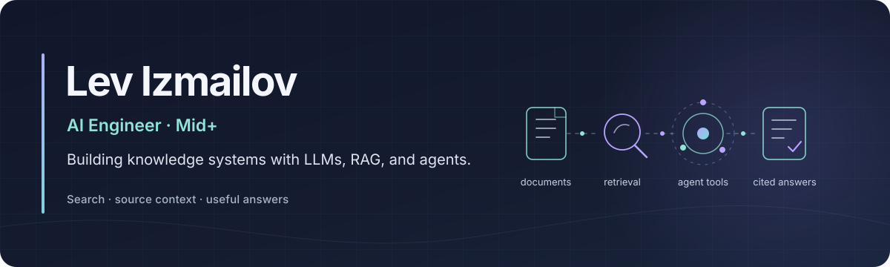

  

  
  
  

## Current work

I’m an **AI Engineer (Mid+)** at **FGAU «CIT»** in Moscow. I build systems for scientific search and article preparation, connecting document retrieval, LLM workflows, agent tools, and source-linked interfaces.

## Selected work

### Research search and article preparation

- Designed a system over a closed publication corpus using **LLM Wiki** and **RAG**.
- Built publication processing and indexing with **Qdrant**; integrated **Pi Coding Agent** with tools for source research and article drafts.
- Connected the agent runtime to a web interface with retrieved context and source links; added tool restrictions, streaming, and cancellation.

### Enterprise AI and document workflows

- Adapted **Open WebUI** for enterprise use and built a knowledge-source integration for an AI assistant.
- Worked with local LLMs through **vLLM**, OCR/ASR, external APIs, and document-generation workflows.

### Backend and applied ML

- Built a **Telegram Stars** purchase bot with referrals, Fragment integration, and TON payment verification — Python, aiogram, MySQL.
- Developed a digital-services store API with orders, balances, promotions, partner workflows, and payment integration — FastAPI, PostgreSQL, Celery, Docker.
- Evaluated 21-day purchase prediction with **CatBoost** and **XGBoost**, from data preparation through model analysis and MVP recommendations.

## Toolkit

| Focus | Skills |
| --- | --- |
| **LLM and agents** | RAG, LLM Wiki, Pi Coding Agent, tool calling, MCP, embeddings, reranking, Qdrant |
| **LLM infrastructure** | vLLM, Open WebUI, Hugging Face Transformers, OCR/ASR, document workflows |
| **Backend** | Python, TypeScript, FastAPI, SQLAlchemy, PostgreSQL, MySQL, aiogram, Celery, REST APIs |
| **ML and NLP** | CatBoost, XGBoost, scikit-learn, Pandas, MLflow, Natasha |
| **Infrastructure** | Docker, Linux, Git |

## Research

**Co-author · «Перспективы науки», 2023** 
«Формирование числового кода фрактальной структуры текстурированного оптически анизотропного гластэлита» — Баканов П. П., Измайлов Л. С., Тригуб Н. А., № 5 (164), с. 118–125. 
[Read the paper (PDF)](https://elib.pnzgu.ru/files/eb/d17HQmJ58Bqe.pdf)

## Education

- **MSc, Artificial Intelligence and Machine Learning** — NUST MISIS, 2023–2025 · graduated with honors
- **BSc, Applied Mathematics** — NUST MISIS, 2019–2023

## Contact

Open to applied AI and LLM engineering roles, projects, and collaboration.

[Email](mailto:workizlaster@gmail.com) · [Telegram](https://t.me/izlaster) · [Kaggle](https://www.kaggle.com/izlaster) · [GitHub](https://github.com/Izlaster)
